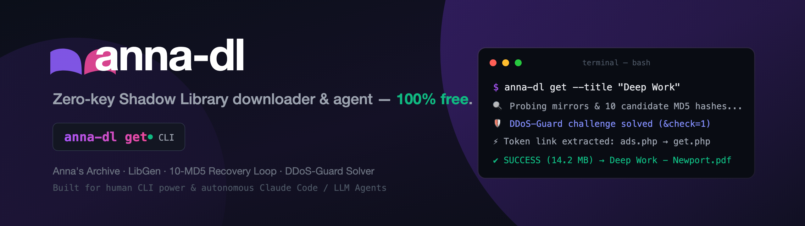
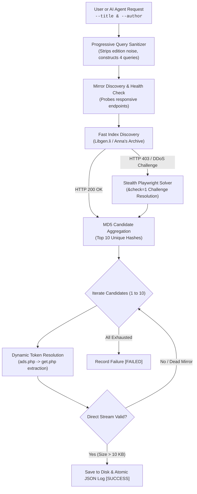

<p align="center">
  
</p>

<p align="center">
  <a href="https://pypi.org/project/anna-dl/"></a>
  <a href="https://www.python.org/downloads/"></a>
  <a href="LICENSE"></a>
  <a href="https://github.com/nsozturk/anna-dl/releases"></a>
  
  
  
</p>

<p align="center">
  <b>Resilient, Zero-Key Shadow Library Downloader CLI & AI Agent</b><br>
  Instant search, multi-mirror recovery, and high-speed streaming for Anna's Archive and Library Genesis (LibGen).
</p>

<p align="center">
  <code>annas-archive</code> • <code>libgen</code> • <code>shadow-library</code> • <code>book-downloader</code> • <code>ebook-downloader</code> • <code>python-cli</code> • <code>ai-agent</code> • <code>claude-code</code> • <code>open-access</code> • <code>research-automation</code>
</p>

---

## ⚡ Highlights & Why anna-dl?

* 🔓 **Zero Paid API Keys Required**: No donation keys or membership tokens needed. Operates freely over verified public mirror endpoints.
* 🚀 **Ultra Lightweight & Fast**: Pure Python core (`requests` + regex). Starts in milliseconds without heavy browser runtimes unless required.
* 🛡️ **DDoS-Guard & Cloudflare Bypass**: Automated fallback with stealth headless Chromium (`--disable-blink-features=AutomationControlled`, `delete navigator.webdriver`) to resolve JS challenges (`&check=1`) seamlessly when plain HTTP encounters `HTTP 403 Forbidden`.
* 🔄 **10-Candidate MD5 Recovery Loop**: Never stops at the first broken link. Extracts up to 10 unique MD5 candidates and sequentially probes working download mirrors.
* ⚡ **Direct Dynamic Token Extraction (`ads.php` → `get.php`)**: Extracts ephemeral download tokens on the fly for high-speed streaming.
* 🔍 **Smart Title Sanitizer**: Automatically cleans editions (`(2nd ed.)`), annotations, and subtitles, creating progressive 4-tier fallback queries.
* 🌐 **Built-in DNS Bypass**: Monkey-patches socket resolution directly to edge IP (`104.21.34.70`) to circumvent regional ISP blocks.
* 📖 **Dual Format Engine (PDF Default + Opt-in EPUB)**: Prioritizes full-fidelity complete PDF editions by default while demoting incomplete pamphlets/flyers (< 150 KB). Includes native `--format epub` support for e-readers (Kobo, Kindle) with automatic magic-byte format validation.
* 🤖 **First-Class AI Agent Interoperability**: Built from the ground up with explicit [AGENTS.md](AGENTS.md) contracts and exit codes for Claude Code, Gemini CLI, Cursor, Antigravity, OpenCode, and Codex.

---

## 🛠️ Retrieval Architecture



---

## 📦 Installation

```bash
# Clone the repository
git clone https://github.com/nsozturk/anna-dl.git
cd anna-dl

# Create an isolated environment (Linux/macOS)
python3 -m venv .venv
source .venv/bin/activate
python -m pip install -e .
```

On Windows, use `py -3 -m venv .venv`, then activate with
`.venv\Scripts\Activate.ps1` in PowerShell or `.venv\Scripts\activate.bat` in
Command Prompt, and run `python -m pip install -e .`.

The CLI needs Python 3.8 or newer. The desktop GUI additionally needs Tkinter
and a graphical desktop session. On Fedora, install Tkinter for system Python
with `sudo dnf install python3-tkinter`; on Debian/Ubuntu use
`sudo apt install python3-tk`. Windows and macOS Python installations must
include Tcl/Tk support. Curl is optional: downloads fall back to Python requests
when curl is unavailable.

### Desktop GUI

From the source checkout, launch with `python3 start_gui.py` on Linux/macOS,
or `py -3 start_gui.py` on Windows. No environment activation is required.
The launcher uses the checkout's `.venv` if present, otherwise the Python you
started it with. If required libraries are missing, it asks whether to install
them. Only a `y`/`yes` answer creates or prepares the local `.venv` and installs
the requirements; declining or having no interactive input exits without
installing anything. It uses the checkout as its working directory, even when
started elsewhere. Tkinter remains a Python/OS prerequisite as described above.
Existing Windows shortcuts to `anna_dl_gui.pyw` also use this launcher.

After installation, `anna-dl gui` (or `anna-dl-gui`) starts the desktop app.
For these installed commands, downloads, the feeder list, and logs default to
the directory you run the command from. CLI and GUI work on Linux, Windows,
and macOS; the GUI reports a clear error if Tkinter or a display is unavailable.

From the parent `anna` folder, use `python3 anna-dl/start_gui.py` to launch and
`git -C anna-dl status` to inspect this repository.

*(Optional: For automatic DDoS-Guard JavaScript challenge resolution on direct Anna's Archive endpoints, install Playwright)*:
```bash
pip install playwright
playwright install chromium
```

---

## 🚀 CLI Usage Guide

### 1. Download a Single Book (`get`)

```bash
# Default: High-quality complete PDF format
anna-dl get --title "Atomic Habits" --author "James Clear"

# Prefer reflowable EPUB format for e-readers (Kobo, Kindle)
anna-dl get --title "Atomic Habits" --author "James Clear" --format epub

# Custom search query override
anna-dl get --title "Thinking, Fast and Slow" --query "Kahneman Thinking Fast"

# Bypass regional or ISP DNS censorship
anna-dl get --title "Deep Work" --author "Cal Newport" --bypass-dns

# Custom destination folder
anna-dl get --title "Clean Code" --author "Robert Martin" --output-dir ./library
```

### 2. Batch Download & Recovery (`download` & `retry`)

```bash
# Download entire books_queue.json sequentially
anna-dl download

# High-throughput multi-threaded download (4 parallel workers)
anna-dl download --parallel --workers 4

# Limit attempted books (also works in parallel mode)
anna-dl download --parallel --limit 5

# Filter batch by specific category prefixes
anna-dl download --categories 01,02,03

# Re-attempt failed or incomplete books
anna-dl retry --bypass-dns
```

### 3. Queue Extraction from Markdown Catalogs (`extract`)

Convert markdown tables (`| Title | Author | Year |`) into a clean `books_queue.json`:

```bash
anna-dl extract --docs-dir ./reading-lists/
```

### 4. Disk & Log Synchronization (`sync` & `status`)

```bash
# Verify downloaded files against log
anna-dl sync

# Display overall archive health & counts
anna-dl status
```

Completed batch attempts return exit code 0 only when all attempted books
succeeded; failed attempts return 1 and invalid command arguments return 2.
Disk synchronization and resume checks require an exact filename in the
book's category folder and a recognized document format. PDF, EPUB, MOBI/AZW3,
and DjVu are supported; EPUB validation also checks its ZIP entries and
`mimetype`. These checks do not verify every document's internal structure or
that a file's contents match its catalogue record.

Partial downloads resume only within retries for the same candidate in one
run. A new candidate or run starts fresh to avoid mixing different editions.
Portable filenames retain their extension, handle Windows reserved names, and
use a short hash when truncating long UTF-8 names.

### Running the regression tests

With the virtual environment activated:

```bash
python -m unittest discover -s tests -v
```

The tests use temporary files and controlled transport responses. They do not
contact external mirrors or download books. CI runs them on Linux, Windows,
and macOS with Python 3.8, 3.11, and 3.14.

---

## 🤖 AI Agent Integration

`anna-dl` includes native root agent instructions ([AGENTS.md](AGENTS.md)) and an importable global rule snippet ([GLOBAL_AGENT_RULE.md](GLOBAL_AGENT_RULE.md)).

Copy `GLOBAL_AGENT_RULE.md` into your AI environment (`~/.claude/agents/anna-dl.md`, `~/.config/agent-rules/anna-dl.md`, or Cursor project rules) to give your LLM agent autonomous literature lookup capabilities.

---

## 🌐 2026 Mirror Network Status

> [!NOTE]
> `annas-archive.org` and `annas-archive.se` were seized in mid-2026. `anna-dl` automatically maintains the current roster of active, verified working mirrors:

* **Anna's Archive:** `https://annas-archive.gl` (Primary Default), `https://annas-archive.pk`, `https://annas-archive.gd`, `https://annas-archive.vg`
* **Library Genesis:** `libgen.la`, `libgen.gl`, `libgen.vg`, `libgen.is`, `libgen.rs`, `libgen.li`

---

## 🏷️ Release History

### **v1.0.0 (Initial Stable Release)**
- ✨ **Zero-Key Architecture:** Complete multi-mirror search without requiring paid API keys.
- 🛡️ **DDoS-Guard Evasion:** Stealth headless browser fallback resolving JS tests and `&check=1` redirects.
- 🔁 **10-Candidate Loop:** Resilient sequential fallback across top 10 MD5 hashes.
- ⚡ **Dynamic Token Extraction:** Real-time token acquisition via `ads.php` → `get.php`.
- 🔌 **Agent Contracts:** Full `AGENTS.md` and `GLOBAL_AGENT_RULE.md` specifications.

---

## ⚖️ Disclaimer

`anna-dl` is an educational open-source software project designed for researchers, educators, and archivists to discover and retrieve open-access and public domain scientific literature. The maintainers do not host or distribute copyright-infringing materials. Users are responsible for complying with the local laws of their respective jurisdictions.

---

## 📄 License

Distributed under the [MIT License](LICENSE).
